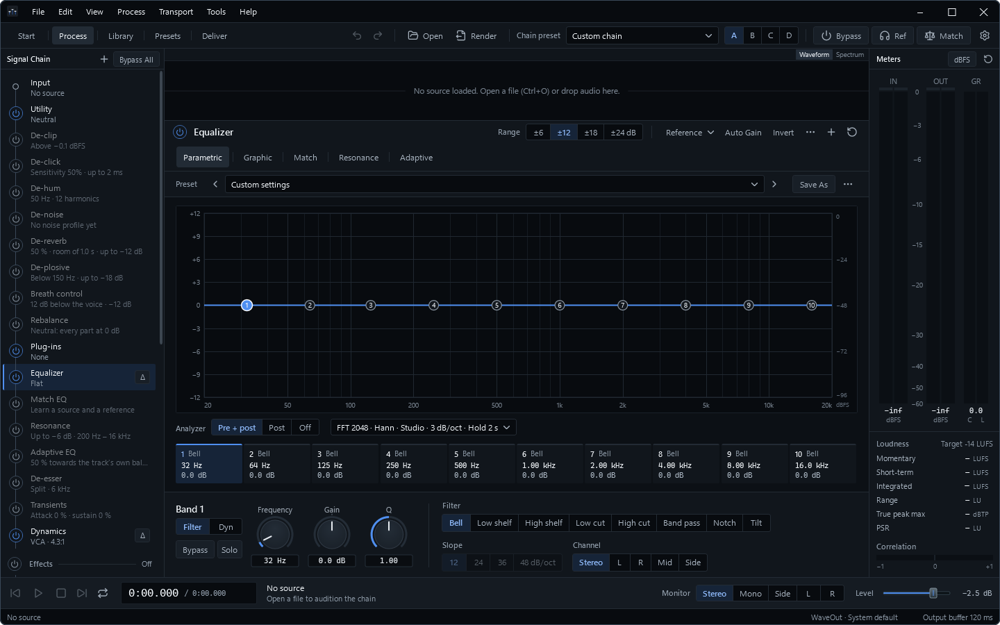

  

<h1 align="center">Fidena</h1>

<strong>Audio Processing Studio for Windows</strong>

Shape, repair, master and deliver your sound in one signal chain.

  <a href="https://github.com/Arctisoft-Studio/Fidena-Audio-Processing-Studio/releases/latest"><strong>Download</strong></a> ·
  <a href="https://arctisoft-studio.com/software/fidena/">Product website</a> ·
  <a href="https://arctisoft-studio.com/pricing/">Editions &amp; pricing</a> ·
  <a href="https://github.com/Arctisoft-Studio/Fidena-Audio-Processing-Studio/releases">Release notes</a> ·
  <a href="https://arctisoft-studio.com/support/">Support</a>

 

The Process workspace: signal chain, parametric equaliser with pre/post analyser, and input, output and loudness metering. More views in the <a href="https://arctisoft-studio.com/software/fidena/">product gallery</a>.

Fidena is the audio processing studio of Arctisoft Studio. Build a chain of equalisation, dynamics, repair, mastering and effects for your material, compare alternatives while you listen, check the result against a delivery target and render it — one file, a whole album, or unattended batches. Its processors are also available as VST3 plug-ins in your DAW.

## Capabilities

- **An editable signal chain.** Add, reorder, bypass and repeat processor instances. Compare four complete chains as snapshots A–D, keep module and chain presets, and save source, chain, edits and markers as a session. Full undo history and automatic recovery copies protect the work in progress.
- **Equalisation.** Parametric, dynamic and graphic EQ with linear-phase options, Match EQ against a reference, resonance suppression and adaptive EQ, with a pre/post analyser.
- **Dynamics and mastering.** Compressor, multiband dynamics, gate and expander, de-esser, transient shaping, true-peak limiter with loudness targets, stereo imaging, mono-maker, rebalance and a mastering assistant.
- **Repair.** De-clip, de-click, de-hum, de-noise, de-reverb, de-plosive and breath control, a repair assistant, and spectral repair of selected regions in the spectrogram.
- **Effects.** Algorithmic and convolution reverb, delay, saturation and tape, modulation, creative effects, and pitch and time with formant control.
- **Plug-in hosting.** Host your own VST3 effects in the chain, each in its own process, so a failing plug-in cannot take the session down.
- **Listening and delivery.** Loudness, true peak, spectrum and stereo metering, reference comparison, codec preview, and pass/fail measurement against published delivery targets such as EBU R 128, ATSC A/85, AES TD1008, Spotify, Netflix and Apple Podcasts.
- **Surround and immersive.** Process channel beds from mono to 7.1.4, choose the channels each processor acts on, and render WAV with ADM BWF metadata.
- **Rendering.** WAV, FLAC, MP3, Ogg Vorbis and AAC. Render sets produce several formats from one pass; album rendering levels and renders a track list; job files, watch folders and `fidena-cli` run work unattended.
- **Fidena in your DAW.** Nineteen module plug-ins and Fidena Chain, which runs a complete chain, as VST3 plug-ins with automation, factory presets and reported latency.

Audio devices are driven through WaveOut, WASAPI shared or exclusive, DirectSound or ASIO, and knobs accept MIDI learn. An offline user guide and keyboard reference are built into **Help**.

## Editions

Every processor can be heard and adjusted in both editions. The editions differ in what a render contains and in the ways of rendering. Before a Basic render leaves anything out, Fidena names it and lets you continue, start the trial or upgrade — a render never changes without saying so first.

| | Basic · free | Premium |
| --- | :---: | :---: |
| Equaliser, compressor, gate, reverb, delay, saturation, tremolo, vibrato, pan, reverse, bitcrush | Render | Render |
| Repair, advanced EQ, multiband, mastering, stereo, pitch/time, chorus and other advanced processors | Hear and adjust | Render |
| Hosted VST3 effects | Hear and adjust | Render |
| Limiter | Standard settings | Your mastering settings |
| WAV, FLAC, MP3, Ogg Vorbis and AAC export | ✓ | ✓ |
| Sample rate and word length | Up to 48 kHz, 24-bit | Up to 192 kHz, 32-bit float |
| Loudness normalisation | Peak | Peak and LUFS targets |
| Batch rendering, job files and watch folders | One file at a time | ✓ |
| Render sets and album rendering | — | ✓ |
| Command line | Analyse | Analyse and render |
| Measurement, delivery targets, codec preview and reports | ✓ | ✓ |
| Fidena VST3 plug-ins for your DAW | — | ✓ |
| Settings follow your account | ✓ | ✓ |
| Equaliser presets follow your account | — | ✓ |

Premium is a one-time purchase for one person, covering the licensed major version and all updates within it, on up to three computers at a time; a licensed computer keeps working offline for 30 days. A 14-day trial is available once per account and computer. See [current pricing](https://arctisoft-studio.com/pricing/); **Help > License** shows the state of this computer.

## System requirements

| | |
| --- | --- |
| Operating system | Windows 10 or Windows 11, 64-bit (x64) |
| Runtime | Included with the installer |
| Installation | For your Windows user account; administrator rights are not required |
| Audio | Any Windows audio device; ASIO drivers are supported |
| Plug-ins | A VST3 host, for the Fidena plug-ins and for hosting third-party effects |
| Internet | For sign-in, licensing, sync and updates; processing and rendering work offline |

Fidena opens WAV (including RF64, BW64 and multichannel WAV), AIFF, FLAC, MP3, AAC, M4A and Apple Lossless, WMA, Ogg Vorbis and Opus.

## Installation and updates

1. Download `v<version>-fidena.exe` from the [latest release](https://github.com/Arctisoft-Studio/Fidena-Audio-Processing-Studio/releases/latest).
2. Run the installer and accept the license agreement. Setup can also install the VST3 plug-ins and, optionally, [Arctisoft Studio Hub](https://github.com/Arctisoft-Studio/Arctisoft-Studio-Hub).
3. Start Fidena. Sign in through Studio Hub when you want Premium, the trial or sync.

Fidena checks this repository for updates and installs a new version only after verifying it against the SHA-256 checksum GitHub publishes for the release. Studio Hub can install and update the whole Arctisoft collection from one place.

## Accounts and privacy

Processing and rendering run entirely on your computer. Fidena sends no audio and no file information anywhere, and contains no analytics or telemetry. Local use does not require an account; signing in through Studio Hub enables Premium, the trial and optional settings sync, which is off until you turn it on. The [Privacy Policy](https://arctisoft-studio.com/legal/privacy/) describes the account and license data involved.

## Support

Open the user guide from **Help**, visit [Arctisoft Support](https://arctisoft-studio.com/support/) or write to [support@arctisoft-studio.com](mailto:support@arctisoft-studio.com). Report reproducible problems and suggest improvements through [GitHub Issues](https://github.com/Arctisoft-Studio/Fidena-Audio-Processing-Studio/issues). Please keep license keys, account details and private recordings out of public reports.

## License

Fidena is proprietary commercial software. This repository holds its public documentation and official releases; the source code is not published. Use is governed by the [Fidena EULA](LICENSE), the [Arctisoft Studio License Agreement](https://arctisoft-studio.com/legal/license/) and the [Terms of Service](https://arctisoft-studio.com/legal/terms/). Open-source components are listed with their licenses in `THIRD-PARTY-NOTICES.txt` in the installation folder. VST is a registered trademark of Steinberg Media Technologies GmbH.

---

© 2025–2026 Arctisoft Studio · Bernd Julian Hagen · Austria. All rights reserved.

